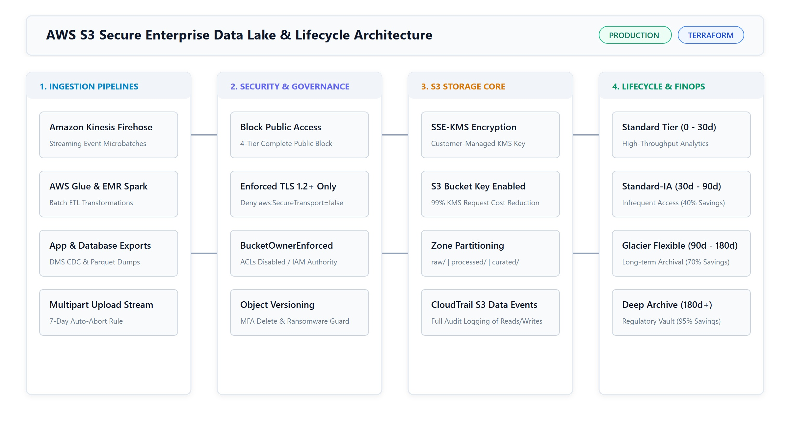

# :rocket: Terraform AWS S3 Secure Data Lake

<p align="center">
  
</p>

<div align="center">

[]()
[]()
[](LICENSE)
[](https://github.com/tayyabmasood911/terraform-aws-s3-secure-data-lake/pulls)
[]()

</div>

---

## :memo: Executive Summary

**Terraform AWS S3 Secure Data Lake** is an enterprise-grade Infrastructure-as-Code (IaC) repository that provisions a zero-trust, compliance-ready Amazon S3 data lake. Designed for petabyte-scale big data architectures, analytical pipelines, and machine learning storage, this module enforces strict four-tier public access blocks, customer-managed KMS encryption, S3 Bucket Keys, and multi-tier FinOps lifecycle policies.

Key operational outcomes:
- **Zero-Trust Security:** Mandatory TLS 1.2+ transport security, complete public access blocking, and ACL elimination (`BucketOwnerEnforced`).
- **FinOps Optimization:** Automated hierarchical tiering (Standard -> Standard-IA -> Glacier Flexible -> Deep Archive) reducing storage costs by up to 95%.
- **KMS Cost Reduction:** S3 Bucket Key reduces KMS request traffic and per-call charges by 99% during high-throughput ETL jobs.
- **Ransomware & Tamper Defense:** Native object versioning with lifecycle cleanup protects critical data assets against accidental deletion and unauthorized overwrites.

---

## :building_construction: System Architecture

```text
+---------------------------------------------------------------------------------------------------+
|                         AWS S3 Secure Data Lake Architecture Blueprint                            |
|                                                                                                   |
|   +--------------------------+         +------------------------------------------------------+   |
|   | Ingestion Sources        | ======> | Security & Access Governance Barrier                 |   |
|   | - Kinesis Data Firehose  |  TLS1.2 | - S3 Public Access Block (All 4 flags enforced)      |   |
|   | - AWS Glue & EMR Spark   |         | - BucketOwnerEnforced (ACLs Disabled)                |   |
|   | - App CDC & Event Streams|         | - Bucket Policy: Deny non-TLS & unencrypted uploads   |   |
|   +--------------------------+         +------------------------------------------------------+   |
|                                                                   |                               |
|                                                                   v                               |
|                                        +------------------------------------------------------+   |
|                                        | Amazon S3 Storage Core                               |   |
|                                        | - Customer Managed KMS Key (SSE-KMS)                 |   |
|                                        | - S3 Bucket Key Enabled (99% KMS Request Savings)    |   |
|                                        | - Partitions: raw/ | processed/ | curated/           |   |
|                                        | - Object Versioning & CloudTrail Audit Tracking      |   |
|                                        +------------------------------------------------------+   |
|                                                                   |                               |
|                                                                   v                               |
|                                        +------------------------------------------------------+   |
|                                        | Multi-Tier Lifecycle & FinOps Optimization           |   |
|                                        | - Day 0 to 30:   S3 Standard (High Throughput)       |   |
|                                        | - Day 30 to 90:  S3 Standard-IA (Infrequent Access)  |   |
|                                        | - Day 90 to 180: S3 Glacier Flexible (70% Savings)   |   |
|                                        | - Day 180+:      S3 Glacier Deep Archive (Vault)     |   |
|                                        | - 7-Day Auto-Abort on Incomplete Multipart Uploads   |   |
|                                        +------------------------------------------------------+   |
+---------------------------------------------------------------------------------------------------+
```

---

## :sparkles: Key Enterprise Capabilities

- :zap: **S3 Bucket Key Cost Optimization:** Decouples object encryption requests from AWS KMS pricing, achieving up to 99% cost reduction during heavy Spark and Athena read/write cycles.
- :shield: **Zero-Trust Access Control:** Disables legacy S3 Access Control Lists (ACLs) entirely, centralizing identity and permission governance through AWS IAM and bucket policies.
- :arrows_counterclockwise: **Intelligent Multi-Stage Lifecycle:** Seamlessly migrates older telemetry and historical transactions across storage tiers without data rehydration overhead.
- :recycle: **Orphaned Multipart Cleanup:** Automatically identifies and purges stalled multipart chunk uploads older than 7 days, preventing silent billing accumulation.
- :lock: **TLS 1.2+ Cipher Enforcement:** Strictly repudiates any inbound request lacking modern TLS cryptographic protection (`aws:SecureTransport = false` or `s3:TlsVersion < 1.2`).

---

## :file_folder: Repository Directory Structure

```text
.
|-- .github/             # Automated CI workflows for Terraform linting and validation
|-- config/              # Example environment variable templates
|-- docs/
|   `-- images/          # White-theme architectural blueprints and vector diagrams
|       |-- architecture.svg
|       `-- architecture-white.jpg
|-- scripts/             # Operational validation and health check tooling
|-- tests/               # Python-based syntax and policy validation tests
|-- .gitattributes       # Linguist configuration ensuring accurate language detection
|-- LICENSE              # MIT Open Source License
|-- lifecycle.tf         # Multi-tier lifecycle transition and retention rules
|-- main.tf              # S3 bucket, encryption, public access block, and security policies
|-- Makefile             # Operational targets for formatting, linting, and testing
|-- outputs.tf           # Exported bucket names, ARNs, and regional endpoints
|-- README.md            # Enterprise architectural documentation
|-- SECURITY.md          # Vulnerability disclosure and security policy
`-- variables.tf         # Parameterized configuration inputs and thresholds
```

---

## :zap: Quick Start & Deployment

### Prerequisites
- Terraform `>= 1.5.0`
- AWS CLI configured with S3 and KMS permissions
- Optional: Existing AWS KMS Customer Managed Key (CMK)

### Deployment Steps
```bash
# 1. Clone the repository
git clone https://github.com/tayyabmasood911/terraform-aws-s3-secure-data-lake.git
cd terraform-aws-s3-secure-data-lake

# 2. Inspect and configure input variables
cp config/production.env.example .env

# 3. Initialize Terraform and validate configuration
terraform init
terraform fmt -check
terraform validate

# 4. Generate deployment execution plan
terraform plan \
  -var="bucket_prefix=enterprise-analytics-lake-" \
  -var="environment=production" \
  -out=tfplan

# 5. Apply infrastructure changes
terraform apply tfplan
```

---

## :gear: Configuration Reference

| Parameter | Type | Default | Description |
| :--- | :--- | :--- | :--- |
| `bucket_prefix` | string | `prod-data-lake-` | Unique naming prefix assigned to the created S3 bucket |
| `environment` | string | `production` | Deployment environment tier (`production`, `staging`) |
| `enable_versioning` | bool | `true` | Enables object versioning for anti-ransomware protection |
| `kms_key_arn` | string | `null` | Customer Managed KMS Key ARN (null defaults to AWS-managed key) |
| `transition_days_ia` | number | `30` | Days elapsed before transitioning objects to S3 Standard-IA |
| `transition_days_glacier` | number | `90` | Days elapsed before transitioning objects to Glacier Flexible |
| `transition_days_deep_archive` | number | `180` | Days elapsed before transitioning objects to Glacier Deep Archive |
| `expiration_days_noncurrent` | number | `365` | Days before permanently deleting superseded object versions |
| `force_destroy` | bool | `false` | Prevents destruction if bucket contains active objects |

---

## :lock: Security, Compliance & Governance

1. **Deny Unencrypted PutObject:** Enforces mandatory `s3:x-amz-server-side-encryption: aws:kms` on all object uploads.
2. **Encrypted Transport Only:** Non-TLS (plain HTTP) and legacy TLS versions (< 1.2) are blocked at the perimeter.
3. **Public Access Lockdown:** All four S3 Block Public Access flags are permanently set to `true`.
4. **Ownership Centralization:** `BucketOwnerEnforced` guarantees that the AWS bucket owner owns all deposited objects.

---

## :bust_in_silhouette: Author & Maintainer

**Tayyab Masood**  
Cloud Solutions Architect & Senior DevOps Engineer  
- :globe_with_meridians: **GitHub:** [@tayyabmasood911](https://github.com/tayyabmasood911)  
- :scroll: **Certification:** AWS Certified Solutions Architect - Associate  

---

## :page_facing_up: License

This project is licensed under the **MIT License** - see the [LICENSE](LICENSE) file for details.
